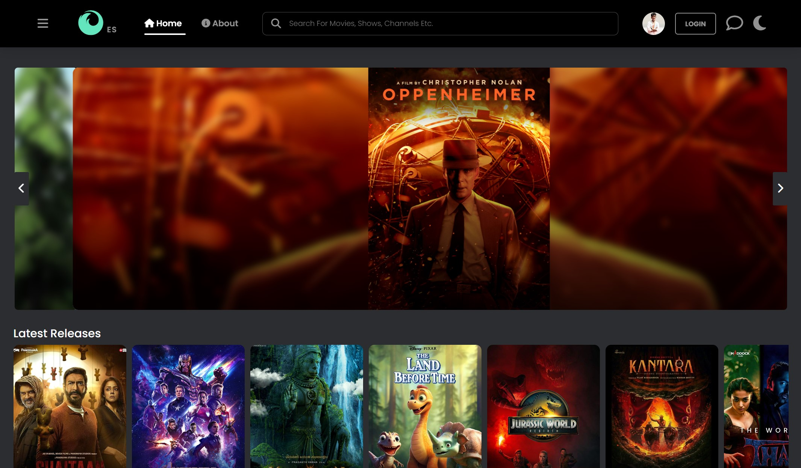

# 🎬 Entertainment Studio

🌟 Welcome to **Entertainment Studio**, a modern and responsive OTT-style entertainment platform where users can explore movies, TV shows, anime, and other entertainment content. Built with an interactive interface, user authentication, personalized profiles, and dark/light mode, the platform provides an engaging browsing experience across different devices. 🌟

## 🕶️ Preview



## 📝 Overview

Entertainment Studio is a full-stack web development project inspired by modern streaming platforms. It allows users to browse entertainment content by category, search for their favorite titles, create an account, and personalize their profiles. With a responsive UI and interactive features, the platform aims to deliver a smooth and user-friendly entertainment experience.

## 💎 Key Features

- **Responsive Design:** Enjoy a seamless browsing experience across desktops, tablets, and mobile devices.
- **Entertainment Catalog:** Explore movies, TV shows, anime, and other content organized into categories.
- **Search Functionality:** Search for entertainment titles quickly and easily.
- **User Authentication:** Register and log in securely with password hashing and email OTP verification.
- **Profile Management:** Update profile information, upload or remove profile photos, and manage social media links.
- **Dark/Light Mode:** Switch between themes according to your preference.
- **Interactive UI:** Navigate through content cards, sliders, sidebars, and other dynamic interface elements.
- **Feedback Form:** Submit feedback and suggestions through the integrated feedback form.
- **Backend Integration:** Store user information and retrieve entertainment content through a backend API.

## 🛠️ Technologies Used

- **HTML5:** Structure the website's pages and content.
- **CSS3:** Create responsive layouts, styling, animations, and theme designs.
- **JavaScript:** Implement interactive features, search, sliders, form handling, and API integration.
- **Node.js:** Run the backend server.
- **Express.js:** Build REST API endpoints and handle application requests.
- **MySQL:** Store user details and entertainment content.
- **Multer:** Handle profile image uploads.
- **bcrypt:** Hash passwords securely.
- **JWT:** Support token-based authentication.
- **Nodemailer:** Handle email-based OTP verification.
- **Vercel:** Deploy the frontend.
- **Render:** Deploy the backend.

## 🚀 Getting Started

Follow these steps to run the project locally.

### 1. Clone the Repository

```bash
git clone https://github.com/ayushgholap2104/Entertainment-Studio.git
```

### 2. Navigate to the Project Directory

```bash
cd Entertainment-Studio
```

### 3. Set Up the Backend

```bash
cd Backend
npm install
```

Create a `.env` file and configure the required environment variables for your database, authentication, and email services.

Start the backend server using the appropriate script from `package.json`, for example:

```bash
npm start
```

### 4. Run the Frontend

Open the frontend's `Home.html` file in your browser, or use a local development server for a better development experience.

**Note:** Ensure the backend is running and the database and environment variables are configured correctly before using features that require API access.

## 🤝 Contributing

Contributions to improve Entertainment Studio, add features, or fix bugs are welcome!

1. Fork the repository.
2. Create a new branch:

   ```bash
   git checkout -b feature-name
   ```

3. Make your changes and commit them:

   ```bash
   git add .
   git commit -m "Add feature or fix"
   ```

4. Push your branch:

   ```bash
   git push origin feature-name
   ```

5. Open a pull request on the original repository.

## 📄 License

Check out the license ✒ [License](LICENSE.txt)
